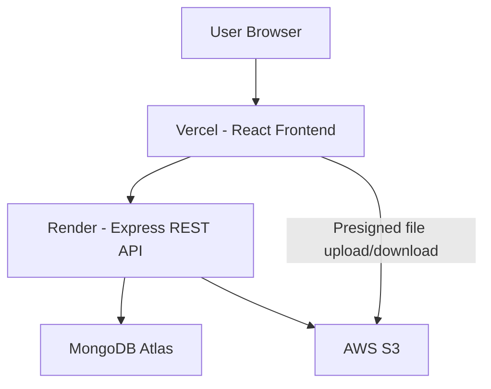

# KGK Cloud Storage

A full-stack cloud storage application that allows users to securely upload, organize, access, share and manage their files through a web interface.

**Live Demo:** https://kgk-cloud-storage-frontend.vercel.app/

**Backend Health:** https://kgk-cloud-storage-1.onrender.com/api/health

## Project Overview

KGK Cloud Storage is a cloud-based file management application developed using React, Node.js, Express, MongoDB Atlas and Amazon S3.

The application uses MongoDB Atlas to store user accounts and file metadata, while Amazon S3 stores the actual files. The frontend communicates with a REST API hosted on Render.

## Features

- User registration and login with JWT authentication.
- Password hashing using bcrypt.
- File uploads directly to private Amazon S3 using presigned URLs.
- File downloads and supported file previews.
- Folder creation, renaming and organization.
- File search, filtering and sorting.
- Shareable file links with expiration.
- File version upload, history and restoration.
- File and associated version deletion.
- Upload size validation and S3 object verification.

## Technology Stack

| Layer | Technologies |
|---|---|
| Frontend | React, Vite, JavaScript, CSS |
| Backend | Node.js, Express.js |
| Database | MongoDB Atlas, Mongoose |
| Cloud storage | Amazon S3 |
| Authentication | JWT, bcrypt |
| Security | CORS, Helmet, API rate limiting |
| Frontend hosting | Vercel |
| Backend hosting | Render |
| Version control | Git, GitHub |

## Architecture



### How it works

1. Users register and authenticate through the backend API.
2. User accounts, folders and file metadata are stored in MongoDB Atlas.
3. The backend generates short-lived presigned S3 URLs.
4. The browser uploads file contents directly to private Amazon S3.
5. The backend verifies uploaded objects and updates MongoDB metadata.
6. Downloads, previews, sharing and file version operations use the backend and private S3 storage.

## Live Deployment

| Component | Platform |
|---|---|
| Frontend | Vercel |
| Backend | Render |
| Database | MongoDB Atlas |
| File storage | AWS S3 |

## Local Development

### Prerequisites

- Node.js 20 or newer
- npm
- MongoDB Atlas account or local MongoDB
- AWS account and private S3 bucket

### 1. Clone the repository

```bash
git clone https://github.com/Karabasu2004/kgk-cloud-storage.git
cd kgk-cloud-storage
```

### 2. Configure the backend

```bash
cd backend
npm ci
```

Copy `.env.example` to `.env` and configure the required local development settings.

Start the backend:

```bash
npm run dev
```

The local backend normally runs at:

`http://localhost:5000`

### 3. Configure the frontend

Open another terminal:

```bash
cd frontend
npm ci
```

Copy `.env.example` to `.env` and configure:

```env
VITE_API_BASE_URL=http://localhost:5000/api
```

Start the frontend:

```bash
npm run dev
```

Open:

`http://localhost:5173`

## Testing

Run backend tests:

```bash
cd backend
npm test
```

Build the frontend:

```bash
cd frontend
npm run build
```

The latest local verification completed with 45 backend tests passing and the Vite production build succeeding.

## Security and Configuration

- Keep AWS credentials, MongoDB connection strings and JWT secrets outside source control.
- Use environment variables for deployment configuration.
- Keep Amazon S3 Block Public Access enabled.
- Use short-lived presigned URLs instead of permanent public file URLs.
- Configure exact frontend origins for API and S3 CORS.
- Enforce upload limits and verify uploaded object sizes.
- Apply authentication, ownership checks, rate limits and security headers.

Never commit `.env` files or real credentials.

## Deployment Documentation

See [DEPLOYMENT.md](DEPLOYMENT.md) for Render, Vercel, MongoDB Atlas and AWS S3 configuration details.

## Project Purpose

This project was developed as a practical learning and portfolio project to explore full-stack development, REST API design, cloud object storage, database persistence, authentication and cloud deployment.

**Developer:** Karabasappa G. Karinagannanavar

**GitHub:** https://github.com/Karabasu2004