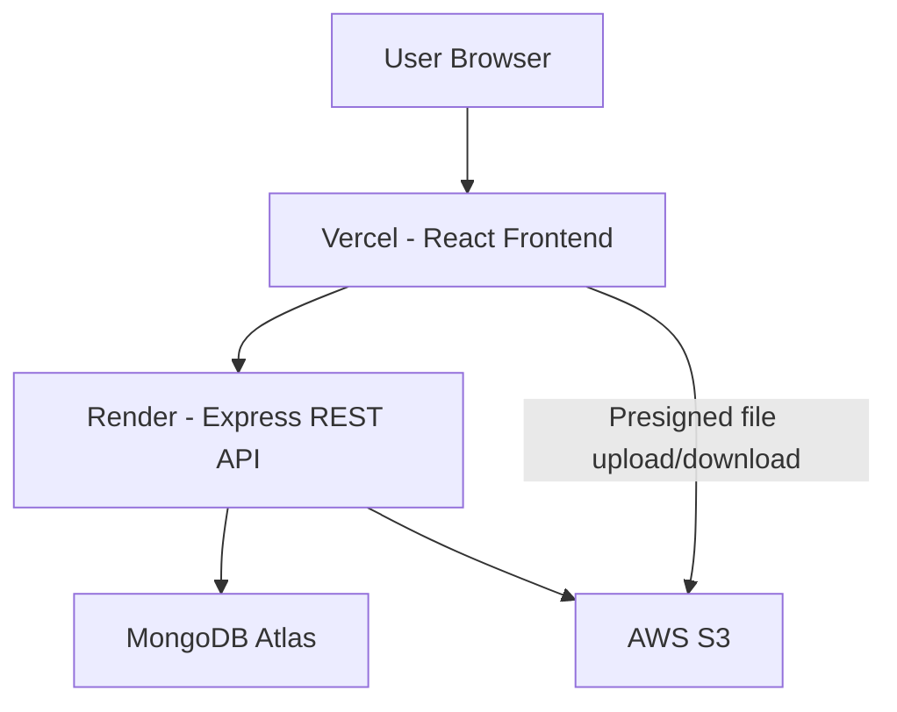

# KGK Cloud Storage

A full-stack cloud storage application that allows users to securely upload, organize, access, share and manage their files through a web interface.

**Live Demo:** https://kgk-cloud-storage-frontend.vercel.app/

**Backend Health:** https://kgk-cloud-storage-1.onrender.com/api/health

## Project Overview

KGK Cloud Storage is a cloud-based file management application developed using React, Node.js, Express, MongoDB Atlas and Amazon S3.

The application uses MongoDB Atlas to store user accounts and file metadata, while Amazon S3 stores the actual files. The frontend communicates with a REST API hosted on Render.

## Features

- User registration and login with JWT authentication.
- Password hashing using bcrypt.
- File uploads directly to private Amazon S3 using presigned URLs.
- File downloads and supported file previews.
- Folder creation, renaming and organization.
- File search, filtering and sorting.
- Recent Files view tracking most recently modified/uploaded files.
- Starred Files view with instant star/unstar toggle and list filtering.
- Trash & Restore: soft-deletion preserves S3 objects/versions while deactivating public shares.
- Permanent Delete: allows permanent removal only from Trash, cleaning up main and version S3 objects with key deduplication.
- Per-user storage and file quotas: backend-enforced 100 MiB storage limit and 10-file limit, with pending reservation tracking and actual-size validation.
- Shareable file links with expiration.
- File version upload, history and restoration.
- Upload size validation and S3 object verification.

## Technology Stack

| Layer | Technologies |
|---|---|
| Frontend | React, Vite, JavaScript, CSS |
| Backend | Node.js, Express.js |
| Database | MongoDB Atlas, Mongoose |
| Cloud storage | Amazon S3 |
| Authentication | JWT, bcrypt |
| Security | CORS, Helmet, API rate limiting |
| Frontend hosting | Vercel |
| Backend hosting | Render |
| Version control | Git, GitHub |

## Architecture



### How it works

1. Users register and authenticate through the backend API.
2. User accounts, folders and file metadata are stored in MongoDB Atlas.
3. The backend generates short-lived presigned S3 URLs.
4. The browser uploads file contents directly to private Amazon S3.
5. The backend verifies uploaded objects and updates MongoDB metadata.
6. Downloads, previews, sharing and file version operations use the backend and private S3 storage.

## File Management & Quota Architecture

### Recent Files
- Retrieved via authenticated `GET /api/files/recent`.
- Sorted by most recently updated (`updatedAt` descending with fallback to `createdAt`).
- Files currently in Trash are automatically excluded.
- Integrated into the Dashboard overview and Recent Files sidebar view.

### Starred Files
- `isStarred` Boolean flag on the File model (defaults to `false` for new and existing records).
- Authenticated `GET /api/files/starred` lists starred files.
- Authenticated `PATCH /api/files/:id/star` toggles star status with ownership checks.
- Trashed files cannot be starred.

### Trash, Restore & Permanent Deletion
- **Soft-Delete (Normal Delete)**: Moves files to Trash (`isDeleted: true`, `deletedAt: timestamp`). Keeps S3 objects and versions intact. Immediately deactivates active public share links.
- **Trash Listing**: Authenticated `GET /api/files/trash` sorts by deletion date (newest first).
- **Restore**: Authenticated `POST /api/files/:id/restore` resets `isDeleted` to `false` and clears `deletedAt`. Preserves S3 objects and versions. Old public share links remain deactivated.
- **Permanent Deletion**: Authenticated `DELETE /api/files/:id/permanent` permanently removes the file only if already in Trash. Deletes main and version S3 objects with key deduplication. Database records are removed only after S3 deletion succeeds. If S3 deletion fails, records are preserved so the user can retry.
- All standard operations (download, preview, rename, move, versioning, public shares) strictly reject trashed files.

### Per-User Storage & File Limits
- **Maximum Storage**: 104,857,600 bytes (100 MiB) per user (configurable via `MAX_USER_STORAGE_BYTES`).
- **Maximum File Count**: 10 files per user (configurable via `MAX_USER_FILES`).
- **Reservation & Safety**: Enforced before presigned upload URLs are generated for both files and versions. Pending uploads reserve declared size so repeated requests cannot bypass limits. Expired pending uploads (>1 hour) are safely ignored.
- **Accounting**: Trashed files count toward the 10-file limit. Stored file versions count toward the storage limit, with identical S3 keys deduplicated.
- **Actual Size Verification**: Actual object size is verified from S3 during confirmation; uploads exceeding quota are rejected and purged from S3.

## Environment Variables

| Variable | Default | Description |
|---|---|---|
| `PORT` | `5000` | Port for Express server |
| `NODE_ENV` | `development` | Runtime environment (`development`, `test`, `production`) |
| `MONGODB_URI` | — | MongoDB Atlas connection string |
| `JWT_SECRET` | — | Secret key for JWT signing (>= 32 bytes in production) |
| `AWS_REGION` | `us-east-1` | AWS S3 region |
| `AWS_S3_BUCKET` | — | Private S3 bucket name |
| `AWS_ACCESS_KEY_ID` | — | AWS IAM Access Key ID |
| `AWS_SECRET_ACCESS_KEY` | — | AWS IAM Secret Access Key |
| `FRONTEND_URL` | `http://localhost:5173` | Allowed frontend origin for CORS |
| `PUBLIC_API_BASE_URL` | — | Public HTTPS API base URL for share links in production |
| `MAX_UPLOAD_SIZE_BYTES` | `52428800` (50 MiB) | Maximum allowed size for a single file upload |
| `MAX_USER_STORAGE_BYTES` | `104857600` (100 MiB) | Total storage quota per user |
| `MAX_USER_FILES` | `10` | Maximum file count per user (including Trash) |

## Local Development

### Prerequisites

- Node.js 20 or newer
- npm
- MongoDB Atlas account or local MongoDB
- AWS account and private S3 bucket

### 1. Clone the repository

```bash
git clone https://github.com/Karabasu2004/kgk-cloud-storage.git
cd kgk-cloud-storage
```

### 2. Configure the backend

```bash
cd backend
npm ci
```

Copy `.env.example` to `.env` and configure the required local development settings.

Start the backend:

```bash
npm run dev
```

The local backend normally runs at:

`http://localhost:5000`

### 3. Configure the frontend

Open another terminal:

```bash
cd frontend
npm ci
```

Copy `.env.example` to `.env` and configure:

```env
VITE_API_BASE_URL=http://localhost:5000/api
```

Start the frontend:

```bash
npm run dev
```

Open:

`http://localhost:5173`

## Testing

Run backend tests:

```bash
cd backend
npm test
```

Build the frontend:

```bash
cd frontend
npm run build
```

The latest local verification completed with 58 backend tests passing and the Vite production build succeeding.

## Security and Configuration

- Keep AWS credentials, MongoDB connection strings and JWT secrets outside source control.
- Use environment variables for deployment configuration.
- Keep Amazon S3 Block Public Access enabled.
- Use short-lived presigned URLs instead of permanent public file URLs.
- Configure exact frontend origins for API and S3 CORS.
- Enforce upload limits and verify uploaded object sizes.
- Apply authentication, ownership checks, rate limits and security headers.

Never commit `.env` files or real credentials.

## Deployment Documentation

See [DEPLOYMENT.md](DEPLOYMENT.md) for Render, Vercel, MongoDB Atlas and AWS S3 configuration details.

## Project Purpose

This project was developed as a practical learning and portfolio project to explore full-stack development, REST API design, cloud object storage, database persistence, authentication and cloud deployment.

**Developer:** Karabasappa G. Karinagannanavar

**GitHub:** https://github.com/Karabasu2004